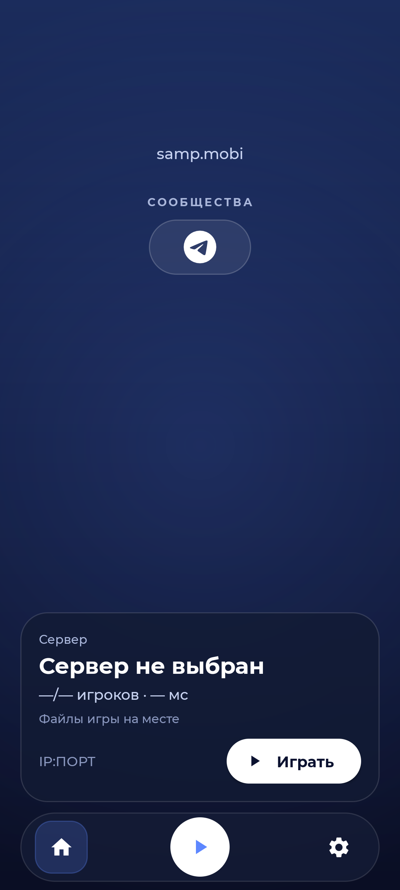
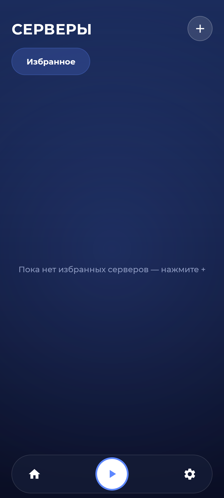
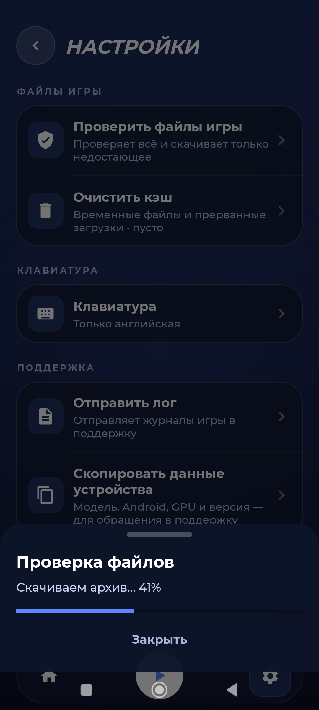

  

<h1 align="center">🎮 GTA 2.11 — SA-MP Mobile</h1>

  <b>Лончер и игра в одном APK.</b> 
  Играй на любом сервере SA-MP 0.3.7 / open.mp прямо с телефона.

  
  

---

## 🇷🇺 Русский

**GTA 2.11** — клиент San Andreas Multiplayer для Android. Лончер и игра собраны в одном APK: установил — и играешь на любом сервере SA-MP 0.3.7 / open.mp. Файлы игры скачиваются автоматически при первом запуске.

### ✨ Возможности

- **Один APK** — лончер и игра вместе, без ПК и эмуляторов
- **Любой сервер SA-MP 0.3.7 / open.mp** — добавляй вручную через «+» или открывай из избранного
- **Живой список серверов** — имя, онлайн/макс, пинг
- **Автозагрузка файлов игры** — при первом запуске (~1.25 ГБ, один раз, лучше по Wi-Fi)
- **Клавиатура** — RU / UA / EN / PT
- **Интерфейс** — русский, украинский, английский, португальский (по языку системы)
- **Чат, инвентарь, TAB-список** — в стиле SA-MP
- **Обновления и поддержка** — в Telegram-канале

### 📲 Установка

1. Скачай [`GTA-2.11.apk`](https://github.com/krasnuy7/SAMP-Mobile-/raw/main/GTA-2.11.apk)
2. Установи APK (Android 9+; разреши установку из неизвестных источников)
3. Открой приложение и выдай **«Доступ ко всем файлам»**
4. Настройки → **«Проверить файлы»** → **«Скачать и установить»** — кеш игры скачается сам
5. Добавь сервер через **+** в разделе «СЕРВЕРЫ» и нажми **«Играть»**

### 📋 Требования

- Android **9.0** (API 28) или новее, ARM64
- ~**1.5 ГБ** свободного места (файлы игры ~1.2 ГБ)
- Интернет для первого запуска

### 🖼 Скриншоты

  
  
  

### 💬 Обратная связь

Нашёл баг или есть предложение? Пиши в Telegram-канал: **https://t.me/samp_android_app**

Тестовый сервер: `s1.ukraine-mobile.online:7771`

---

## 🇬🇧 English

**GTA 2.11** is a San Andreas Multiplayer client for Android. The launcher and the game are packed into a single APK: install it and play on any SA-MP 0.3.7 / open.mp server. Game files are downloaded automatically on first launch.

- One APK — launcher + game, no PC or emulator required
- Any SA-MP 0.3.7 / open.mp server
- Live server list (name, players online/max, ping)
- First-launch cache download (~1.25 GB, Wi-Fi recommended)
- Keyboard RU / UA / EN / PT; UI in Russian, Ukrainian, English, Portuguese
- Chat, inventory, TAB player list

**Install:** download `GTA-2.11.apk` → allow installs from unknown sources → grant "All files access" → Settings → "Check files" → "Download and install" → add a server with **+** → Play.

**Requirements:** Android 9+ (API 28), ARM64, ~1.5 GB free space.

Telegram: https://t.me/samp_android_app

---

## ⚠️ Дисклеймер

Этот клиент **не связан с Rockstar Games / Take-Two Interactive**. Файлы игры не входят в APK — они скачиваются при первом запуске и используются только для подключения к серверам SA-MP. Играйте только на серверах, где это разрешено правилами.
